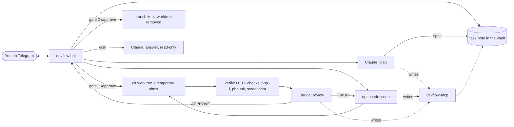

# devflow

**A supervised AI coding workflow you drive from Telegram.** Claude Code plans
and reviews, [opencode](https://opencode.ai) writes the code on a cheaper model,
and you approve twice from your phone: once for the plan, once for the diff.
Every task ends as a git branch you merge yourself, with evidence that the change
works.

```text
/task shop add sorting to the orders table
  → Claude reads the code and writes a spec          → you: /approve   (gate 1)
  → opencode implements it in an isolated worktree
  → devflow checks it: HTTP before/after, lint, tests, screenshot, merge simulation
  → Claude reviews the diff, sends fix-ups back if needed
  → you see the diff stat, evidence and screenshot   → you: /approve   (gate 2)
  → branch kept, worktree removed, decision recorded. You merge.
```

You can also just **ask** about a project from Telegram (`/ask shop where is
checkout validated?`): Claude reads the code and your notes and answers, changing
nothing.

> **Status: early (pre-0.2).** devflow grew out of one developer's setup
> (Windows, PHP apps behind a local nginx, an [Obsidian](https://obsidian.md)
> vault) and is being generalised: it runs on Windows, Linux and macOS, with or
> without a vault, and runs each project's own lint and test commands.
> Temporary sites for HTTP checks still need devcrate (see
> [Known limits](#known-limits)). Issues and pull requests are welcome.

## Why

- **Cost.** Writing code is most of the tokens; judgment is in the plan and the
  review. A strong model does the judgment, a cheaper one does the typing, and
  the strong model still reads every diff.
- **Control.** Agents work unattended, but nothing they do counts until you
  approve it. devflow never merges, never pushes, and never touches your base
  branch. The agents can't either: no git, a deny-by-default shell, writes only
  through narrow, task-bound tools. They are restricted, not sandboxed (see
  [Safety model](#safety-model)).
- **Evidence over claims.** devflow verifies the change itself rather than
  trusting the agent's report.
- **Away from the desk.** Start, steer, approve, or stop work from your phone.

## How it works



| Part | Role |
| --- | --- |
| **Telegram bot** | Your commands in, notifications out. Answers only one allowed chat id |
| **Pipeline** | Moves each task from phase to phase until the next human gate |
| **Claude Code** (`claude -p`) | Planner, reviewer, closer, and the read-only answerer for `/ask`. Never edits project files |
| **opencode** (`opencode serve`) | Worker: implements the spec inside its own git worktree |
| **devflow-mcp** | A small MCP server that is the agents' *only* way to write to the vault, with its rules enforced in code |
| **Verifier** | HTTP checks, `php -l`, phpunit, headless screenshot, `git merge-tree` |

### A task's life

1. **`/task <project> <request>`** logs the request and creates a task note in
   state `new`. Task ids look like `YYMMDD-NN`.
2. **Plan.** Claude reads the request, the project's docs and code (read-only),
   and writes a spec: goal, cause (for bugs, with `file:line`), per-file changes,
   what not to touch, acceptance checks, and a conventional-commit title. If it
   needs a human decision, it asks, and you reply with `/answer`.
3. **Gate 1: `/approve <id>`.** devflow fetches, creates a git worktree on a new
   branch `devflow/<type>/<id>-<slug>` from the freshly fetched base branch, links
   in the gitignored files the app needs to run, and serves the worktree on a
   temporary vhost.
4. **Code.** opencode implements the spec; devflow commits the result.
5. **Verify.** devflow gathers evidence itself (see [Verification](#verification)).
6. **Review.** Claude reads the spec, the diff, and the evidence, then answers
   `APPROVE` or `FIXUP` with a fix-up spec that goes back to the worker. After
   `MAX_BOUNCES` fix-ups the task is parked for you.
7. **Gate 2: `/approve <id>`.** You get the diff stat, the evidence and the
   screenshot (`/diff` for the full patch). The merge is simulated again; if the
   base branch has moved and now conflicts, approval is refused until you
   `/refresh`. On approval the worktree and vhost are removed, the **branch is
   kept**, and Claude records anything worth remembering in the project note.
8. **You merge**, through a pull request or however your team works.

## Telegram commands

| Command | Does |
| --- | --- |
| `/task <project> <request>` | New task. `<project>` is the exact name or any unique part of it |
| `/ask <project> <question>` · `/ask all <question>` | Read-only question about one project or all of them. **Reply to an answer** to follow up in the same conversation |
| `/status` | Active tasks and which ones wait at a gate |
| `/show <id>` | Title, branch, vhost, spec, last review, recent history |
| `/approve <id>` | Gate 1 (plan → coding) or gate 2 (review → done) |
| `/reject <id> <why>` | Gate 1: back to the planner. Gate 2: back to the worker as a fix-up |
| `/answer <id> <answer>` | Same as `/reject`; reads better when the planner asked a question |
| `/diff <id>` | The full diff as a `.diff` file |
| `/retry <id>` | Resume a blocked task in the phase where it stopped |
| `/refresh <id>` | Catch a task up with the latest base branch, then verify and review again |
| `/stop <id>` | Cancel: stop the worker, remove worktree and vhost, keep the branch |
| `/log` · `/log <n>` · `/log <id>` | Recent warnings and errors, or one task's log lines |
| `/help` | The list |

Messages from any other chat are ignored without a reply.

## Safety model

> **Read this before pointing devflow at code you don't fully trust.** The
> agents run as your own user account, with no OS-level sandbox. devflow
> assumes an agent can be steered by malicious text it reads (a file, a commit
> message, a branch name, a web page), so it relies on what agents **cannot**
> do rather than on what they are told. Some gaps remain; they are listed below
> and in [docs/security.md](docs/security.md).

Every rule here is enforced by code or by the agent tool's own permission
system, and has a test that attempts to break it (`tests/test_security.py`).

- **Claude** runs headless with `--permission-mode dontAsk`: it can read and
  search files, and use the devflow-mcp tools its role needs. It has no shell,
  no Write/Edit and no web access, and can't read `DENY_READ` files. It reads
  git history through devflow-mcp's `git` tool, which allows only read-only
  subcommands and safe options, and only paths inside the repository. It reads
  a copy of the project's notes, not your whole vault.
- **opencode** (the worker) runs with a per-session ruleset. Its shell runs
  only the commands in `WORKER_SHELL_ALLOW` (default: `php -l *`); everything
  else is refused, and `git` always is. Its file tools can't read `DENY_READ`
  files or reach outside the worktree. It has no web access and can't start
  subagents. A watchdog rejects any permission prompt that would hang with
  nobody at the terminal and tells you on Telegram. Each run is capped at 45
  minutes.
- **devflow-mcp** is the agents' only way to write notes. Each Claude run gets
  its own instance, bound to one task and one role: the planner writes the
  spec (and can't change it after you approve it at gate 1), the reviewer its
  review, the closer the result and append-only, size-capped project notes,
  which the close message shows you. The worker gets no devflow-mcp at all.
  Agents can't take a human gate.
- **Git**: devflow runs git without hooks or fsmonitor, so nothing planted in
  `.git` runs. If a hook, the git config or a folder linked into the worktree
  (`LINK_PATHS`) changes during a task, the task stops and can't be approved
  until you have looked. devflow commits only on its `devflow/...` branches,
  never merges, pushes or force-pushes, and never changes your base branch or
  your main checkout's working tree.
- **Verification** runs lint and test commands with a minimal environment (no
  tokens), and HTTP checks only against the task's own site: POST/PUT/DELETE
  checks don't touch your checkout's data.
- **Telegram**: only the allowed chat is answered, and in a group only
  `ALLOWED_USER_IDS`. Known secret formats and the values in your projects'
  `DENY_READ` files are masked in logs and messages.

**Not protected** (details in [docs/security.md](docs/security.md)):

- A command you allow the worker that runs code (a test runner, `composer`,
  `npm`, an interpreter) can do anything your user can. So can the tests
  devflow runs during verification. An optional OS-level sandbox for the worker
  is planned.
- A planted hook is caught and never run by devflow, but stays in your main
  checkout's `.git` until you remove it. Read the stop message before you run
  git there.
- Secrets that were ever committed are visible in git history.
- Code and notes go to your model providers, and specs, diffs and answers go
  through Telegram, which is not end-to-end encrypted
  (`SHARE_CODE_VIA_TELEGRAM=false` keeps diffs local).

## Verification

devflow collects evidence itself instead of trusting the worker's account:

- **HTTP checks.** The planner writes a `devflow-checks` JSON block into the spec:

  ````text
  ```devflow-checks
  [{"method": "GET", "path": "/orders", "expect_status": 200, "contains": "Orders"}]
  ```
  ````

  Fields: `path`, `method`, `expect_status`, `contains`, `absent`, `headers`,
  `data`; the block is validated against a schema, and a malformed one fails
  verification with the reason. Each check runs against the task's worktree
  (**after**) and, for GET/HEAD/OPTIONS, the main checkout (**before**); only
  "after" decides pass or fail. HTTP checks need a vhost provider.
- **Lint and tests**: the commands in the project's `[checks]` (`lint`, `test`),
  each with a timeout and a minimal environment. The `php` preset runs
  **`php -l`** on every changed PHP file (with the site's PHP version) and
  **phpunit** or **pest** when the project has them:

  ```toml
  [projects.shop.checks]
  lint = ["npm run lint"]
  test = ["npm test -- --run"]
  ```

  The planner is told which checks will run, so it asks for tests that will.
- **Screenshot** of the first GET check, taken with headless Chromium (Playwright)
  and sent with the gate-2 message.
- **Merge simulation** against the base branch with `git merge-tree`, plus a list
  of other unmerged branches that touch the same files.

## Working alongside a team

devflow assumes other people push to the same repository:

- Before planning, it fetches and tells the planner which other unmerged branches
  were active in the last `OVERLAP_DAYS` and which files they change, and warns
  you when the spec touches one of them.
- Worktrees start from the **fetched** base branch, not from whatever your local
  checkout happens to be on.
- The merge is simulated at verification and again at gate 2.
- `/refresh` rebases a branch that was never pushed, and merges the base branch
  into one that was, so no force-push is ever needed. Conflicts go back to the
  worker; devflow refuses to commit while conflict markers remain.

All git calls run with prompts disabled, so `git fetch` needs a non-interactive
credential (for example a token in Git Credential Manager). Without one, devflow
keeps working on the last-fetched refs and says so in every message.

## Requirements

- **Windows, Linux or macOS**, with **Python 3.11+** and **git**.
- **[Claude Code](https://claude.com/claude-code)** (`claude` on `PATH`, logged in)
  and **[opencode](https://opencode.ai)** (`opencode` on `PATH`, with a provider
  configured).
- **A Telegram bot**: create one with [@BotFather](https://t.me/BotFather); get your
  numeric chat id from [@userinfobot](https://t.me/userinfobot).
- **Optional: a notes vault** (plain Markdown; [Obsidian](https://obsidian.md)
  works well). With one, devflow writes its task notes, requests and project
  decisions there, where you can read and link them:

  ```text
  <vault>/
    01-Projects/<project>.md   project notes (decisions go here)
    04-Requests/                raw requests, written by devflow
    05-Tasks/                   task notes, written by devflow
  ```

  Without one, devflow keeps the same notes in its own runtime folder.
- **Optional, for HTTP checks and screenshots:** a vhost provider. Today that is
  [devcrate](https://github.com/fadjardev/devcrate-stack), a portable Windows
  nginx + PHP stack. Projects without one still go through plan, code, review
  and merge simulation; they skip the HTTP checks and the screenshot.

## Setup

```sh
git clone https://github.com/fadjardev/devflow.git
cd devflow
python -m venv .venv
.venv/bin/python -m pip install -e .          # Windows: .venv\Scripts\python
.venv/bin/python -m playwright install chromium-headless-shell
.venv/bin/devflow init                        # asks for the chat id, a vault, your projects
.venv/bin/devflow doctor
.venv/bin/devflow run
```

`init` writes `devflow.toml` to your user config folder (see
[Configuration](#configuration)). `doctor` checks the settings, file
permissions, the tools on `PATH`, the vhost provider and Playwright, then lists
each project. `run` starts the bot; it greets you with 🟢 on Telegram.

devflow-mcp is wired into each agent run automatically, bound to that run's
task. It is not meant to be added to your own Claude Code sessions.

## Configuration

devflow reads `devflow.toml` from your user config folder
(`%APPDATA%\devflow\` on Windows, `~/.config/devflow/` on Linux,
`~/Library/Application Support/devflow/` on macOS), or the file given with
`--config` or `DEVFLOW_CONFIG`. [`devflow.example.toml`](devflow.example.toml)
documents every setting. In short:

```toml
[telegram]
chat_id = 123456789        # the only chat devflow answers; the token can stay in TELEGRAM_TOKEN
user_ids = []              # required when chat_id is a group

[paths]
# vault = "~/notes"        # optional

[safety]
worker_shell_allow = []    # shell commands the worker may run; everything else is refused

[projects.shop]
path = "~/code/shop"
base_branch = "develop"    # default: the remote's default branch
worker_shell_allow = ["npm run lint"]
```

Every `[projects.<name>]` table can override `base_branch`, `link_paths`,
`deny_read`, `worker_shell_allow` and `check_env_allow`. An unknown or
mistyped setting stops devflow with an error that names it.

**Coming from `.env`?** Without a `devflow.toml`, devflow still reads `.env`
beside the package as before ([`.env.example`](.env.example)), with projects
from the vault's `01-Projects` notes. `VAULT_PATH` and `PROJECTS_PATH` must
be set; nothing falls back to built-in paths anymore. `devflow migrate-env`
writes a `devflow.toml` with the same settings and projects, and keeps the
runtime folder where it is.

## Logs

Everything is logged in the runtime folder (`paths.runtime`; by default your
user data folder, or `runtime/` beside the package with a legacy `.env`), every
line tagged with its task id:

| File | Holds |
| --- | --- |
| `devflow.log` | Everything the bot does: commands, phases and their durations, state changes, agent costs, commits, verification |
| `devflow-errors.log` | Warnings and errors only, with tracebacks |
| `mcp.log`, `mcp-errors.log` | devflow-mcp tool calls, refusals and crashes |
| `opencode-serve.log` | Output of the `opencode serve` process devflow started |

From Telegram, `/log` shows recent problems and `/log <id>` one task's story. A
phase that fails parks its task as `blocked` and tells you which phase; fix the
cause and `/retry`.

## Known limits

- **Pages behind a login** can't be checked automatically yet; HTTP checks and
  screenshots see the login page. The planner names what you must check by hand.
- **"Before" means your main checkout as it is now**, uncommitted changes and
  current branch included.
- **A bot restart** parks tasks that were mid-phase as `blocked`; `/retry` resumes
  them. Tasks waiting at a gate are unaffected. `/ask` follow-ups are kept in
  memory and lost on restart.
- **Telegram limits**: messages are capped at 4096 characters, so long specs and
  diffs are clipped (use `/show`, `/diff`, or the note). Formatting is a small
  Markdown subset; tables and links arrive as plain text.
- **Opening a temporary vhost in your own browser** needs a hosts-file entry;
  devflow doesn't add one. Its own checks don't need it.
- **Temporary vhosts** need devcrate (Windows). With the `none` provider, HTTP
  checks and screenshots are skipped.
- **Cost**: Claude runs on your Claude Code account. A `/ask` answer costs roughly
  $0.30 on the default model; set `CLAUDE_MODEL` to spend less.

## Project layout

| Path | Does |
| --- | --- |
| `devflow/cli.py` | The `devflow` command: `run`, `init`, `migrate-env`, `doctor` |
| `devflow/config.py` | `devflow.toml` and the project registry; the legacy `.env` |
| `devflow/bot.py` | Telegram commands, chat and user allow-lists, `/ask` follow-ups by reply |
| `devflow/pipeline.py` | The phases: plan → gate 1 → code → verify → review → gate 2 → close; `/ask` |
| `devflow/claude.py` | `claude -p` in each role, with its allow-list and secret-file deny rules |
| `devflow/opencode.py` | `opencode serve` client, permission ruleset, and watchdog |
| `devflow/mcp_server.py` | devflow-mcp, bound to one task and role per run: the agents' only write path into notes |
| `devflow/tasks.py` | Task notes and the state machine |
| `devflow/vault.py` | Safe, atomic, locked note writes; Obsidian-tolerant frontmatter |
| `devflow/projects.py` | Project lookup by name and its checkout |
| `devflow/worktree.py` | One git worktree and branch per task; linked-folder snapshots |
| `devflow/gitsafe.py` | Hardened git, `.git` tamper checks, Claude's read-only git check |
| `devflow/vhosts/` | Vhost providers: `none`, `devcrate` (a temporary nginx vhost per task) |
| `devflow/platform.py` | Links, process trees and minimal environments per OS |
| `devflow/redact.py`, `devflow/security.py` | Secret masking; owner-only file permissions |
| `devflow/verify.py` | HTTP checks, lint and tests, headless screenshot |
| `devflow/checks/` | Per-project lint/test commands, the `php` preset, the `devflow-checks` schema |
| `devflow/sync.py` | Fetch, base branch, other unmerged branches, merge simulation |
| `devflow/fmt.py` | Agent Markdown → Telegram HTML, split without breaking code blocks |
| `devflow/logs.py` | Logging setup behind the runtime `*.log` files and `/log` |
| `devflow/prompts/` | The agent prompts: plan, worker, review, close, ask |

## Tests

```sh
python -m pytest -q
```

The suite runs the whole pipeline with faked agents against real git
repositories, including a colleague pushing concurrently, conflicts and
`/refresh`, `/stop`, restart recovery, and a failing phase being parked.

## Contributing

Bug reports, fixes and work that makes devflow run on more setups are welcome.
See [CONTRIBUTING.md](CONTRIBUTING.md) for the development setup, code and
commit conventions, and the extra care needed around the safety model.
Please report security problems privately, not in a public issue.

## License

[MIT](LICENSE)
