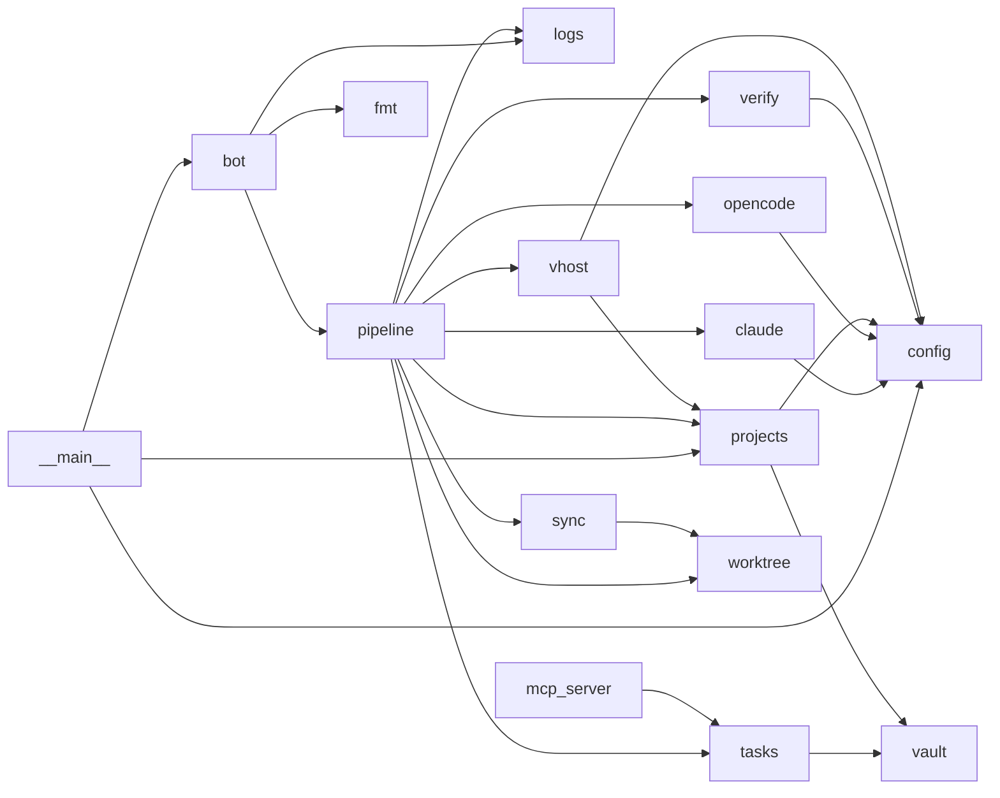
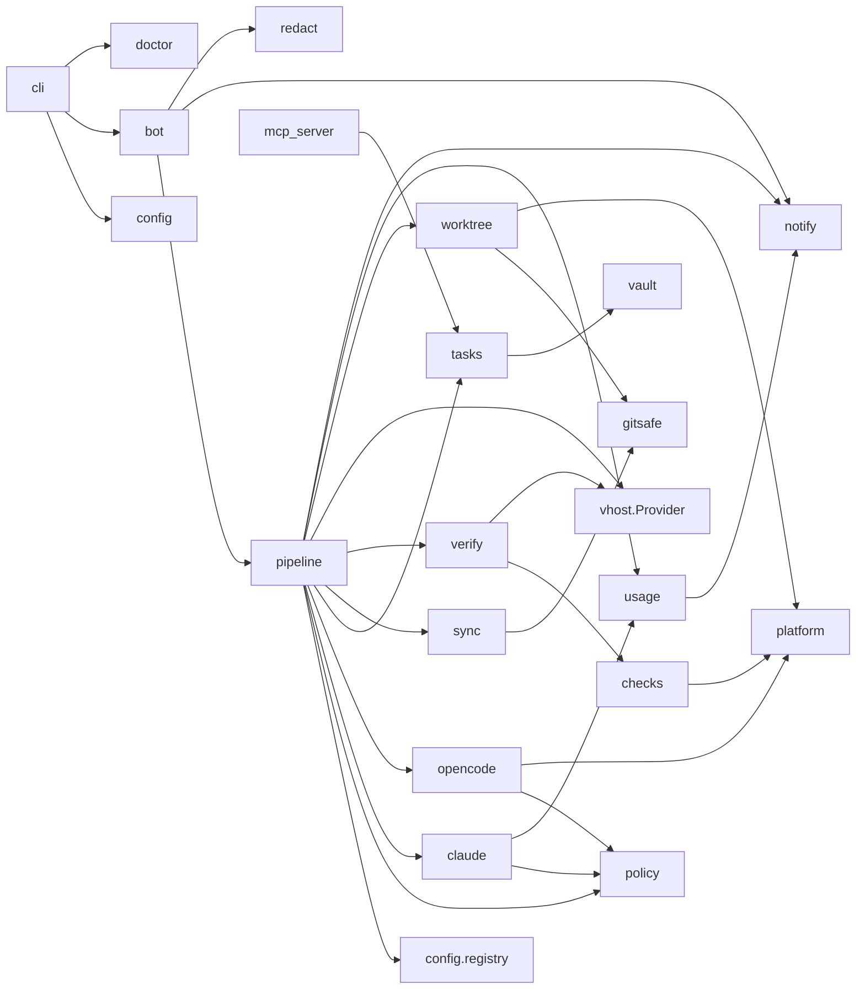
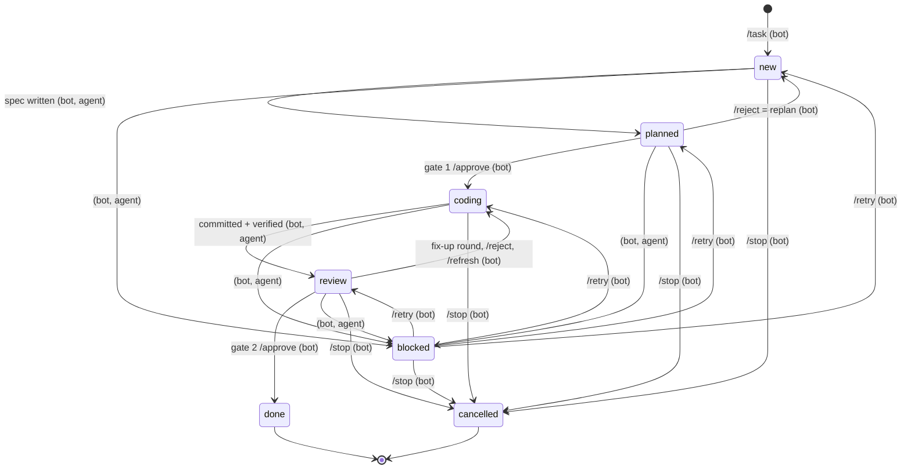

# devflow architecture — current state and v0.2 target

Status: **accepted** (Step 0, 2026-10-30). Based on `main` at `1fdfcd0` and on
the PRD. Decisions taken since are in [`adr/`](adr/).

## 1. Current module map

~2.8k lines in `devflow/`, flat package. Arrows read "imports / calls".

| Module | Lines | Role |
| --- | ---: | --- |
| `__main__.py` | 66 | `python -m devflow` (bot) and `python -m devflow doctor` |
| `config.py` | 68 | `Settings` from env + `.env` beside the repo. Has `E:\dev\...` fallbacks. `REPO_ROOT/runtime`, `REPO_ROOT/prompts` |
| `bot.py` | 388 | python-telegram-bot handlers, chat-id filter, `TelegramNotifier`, `/ask` reply memory, `/log` |
| `pipeline.py` | 576 | `Flow`: plan → gate 1 → work → verify → review/fix-up → gate 2 → close. Defines the `Notifier` protocol (`text`, `photo`) |
| `tasks.py` | 282 | `TaskStore` on vault notes `05-Tasks/<project>/<id>.md`, transition table, request notes, project-note writes |
| `vault.py` | 147 | Markdown + YAML frontmatter `Note`, `safe_path`, file locks in the shared temp dir |
| `projects.py` | 104 | Project discovery from `01-Projects/*.md`, checkout path, **devcrate vhost discovery**, `php.exe` per FastCGI port |
| `claude.py` | 108 | `claude -p` runner, per-role allow-lists, `DENY_READ` → deny rules, `Result(text, session_id, ok, cost_usd)` |
| `opencode.py` | 185 | `opencode serve` client, ruleset, permission watchdog, `taskkill` on close |
| `mcp_server.py` | 92 | devflow-mcp (stdio): five tools over `TaskStore`; vault from env, `E:\dev` fallback |
| `worktree.py` | 128 | git wrapper, branch names, worktree create/remove, **`mklink /J`** links, commit |
| `sync.py` | 143 | fetch, base ref, overlap detection, `merge-tree` check, conflict markers |
| `verify.py` | 173 | `devflow-checks` parser, HTTP before/after, **`php -l`, phpunit/pest**, Playwright screenshot |
| `vhost.py` | 82 | Temp nginx vhost per task (devcrate layout, `nginx.exe -t`/reload) |
| `logs.py` | 138 | Logging setup, task-id context, rotation, `/log` tail |
| `fmt.py` | 83 | Markdown → Telegram HTML, message splitting |

Platform- and setup-specific spots: `config.load()` defaults, `projects.find_vhost`
/ `php_exe` (devcrate layout, `.exe`), `vhost.py` (`nginx.exe`),
`worktree.link_untracked` (`cmd /c mklink /J`), `opencode.Client.close`
(`taskkill`), `__main__.doctor` (nginx, vault layout), `verify.php_lint` /
`phpunit`, and the vault-only project registry (`tasks.check_project`,
`projects.names/resolve/checkout`).

## 2. Target module map (v0.2)

Principle: move code, don't rewrite it. Every new module starts by holding code
that already exists, behind an interface, before it gains behaviour. Package
layout stays flat where a single file is enough.

| Module (new or changed) | Contents | Comes from |
| --- | --- | --- |
| `config/` package | | |
| `config/settings.py` | `Settings` (frozen) + `ProjectConfig` per project | `config.py` |
| `config/toml.py` | load `devflow.toml` (stdlib `tomllib`), validate, clear errors naming the key | new |
| `config/legacy_env.py` | `.env`/env vars → the same `Settings`; deprecation notice | `config.load()` |
| `config/registry.py` | project registry: `[projects.<name>]`; vault `01-Projects` as a fallback source in legacy mode | `projects.names/resolve/checkout/directory`, `tasks.check_project` |
| `config/paths.py` | config dir, data/runtime dir, prompts dir (package data) | `config.REPO_ROOT/RUNTIME_DIR/PROMPTS_DIR` |
| `platform.py` | `link_dir` (junction on Windows, symlink elsewhere), `is_link`, `kill_tree` (taskkill / `killpg`), `new_process_group` flags, `restrict_permissions` (0600/0700, user-only ACL) | `worktree.link_untracked`, `opencode.close`, new |
| `vhost/` package | `VhostProvider` protocol: `find(project) / create(task) / remove(task) / doctor()` | |
| `vhost/none.py` | default: no URL, HTTP checks and screenshot skipped | new |
| `vhost/devcrate.py` | today's nginx/devcrate code, unchanged in behaviour | `vhost.py`, `projects.Vhost/find_vhost/php_exe/sites_dir` |
| `checks/` package | per-project `lint`/`test` command lists with timeouts, minimal env, process-tree kill | `verify.php_lint/phpunit` |
| `checks/presets.py` | `php` preset = today's `php -l` (vhost PHP version) + phpunit/pest | `verify.py` |
| `checks/schema.py` | JSON schema for the `devflow-checks` block | `verify.parse_checks` |
| `verify.py` | orchestration only: checks + HTTP + screenshot → `Evidence`; SR7 URL handling | `verify.py` |
| `gitsafe.py` | devflow's git env (`core.hooksPath`=empty dir, `core.fsmonitor=false`, no aliases), `.git` fingerprint + tamper check | `worktree._ENV`, new |
| `policy.py` | Claude allow-lists (exact git forms, SR5) and the opencode ruleset (deny-by-default shell, SR2) as data, one place to test | `claude.READ_ONLY/NEVER/…`, `opencode.GIT_DENY/ruleset` |
| `redact.py` | logging filter + outbound-message filter (SR9) | new |
| `notify.py` | `Notifier` protocol (`text`, `photo`; later `document`, buttons) + dedup helper | `pipeline.Notifier` |
| `telegram_notifier.py` (or stays in `bot.py`) | Telegram implementation | `bot.TelegramNotifier` |
| `usage/` package | `db.py` (SQLite `runtime/devflow.db`: `usage`, `notifications`, schema version), `capture.py` (Claude JSON / opencode messages → rows), `budget.py` (windows, thresholds, `on_exceed`), `limits.py` (provider-limit detection, `resume_after`), `clock.py` (injectable clock) | new; `claude.Result` gains token fields |
| `tasks.py` | unchanged API; `TaskStore(root)` where root is the vault **or** `runtime/tasks/`; `blocked_reason`, `resume_after` fields | `tasks.py` |
| `mcp_server.py` | bound to one task id + role per run via env (SR6); no machine default | `mcp_server.py` |
| `cli.py` | `devflow` console script: `run`, `init`, `doctor`, `migrate-env` | `__main__.py` |
| `pipeline.py` | same phases; calls registry, vhost provider, checks, usage at phase boundaries | `pipeline.py` |

`prompts/` moves into the package (`devflow/prompts/*.md`, `package-data`) so a
wheel install works. A repo checkout keeps working because the path resolves
from the package.

## 3. Task state machine (from `devflow/tasks.py`)

`/retry` returns to `blocked_from`. The table in `tasks.TRANSITIONS` stays the
only authority. v0.2 adds two fields, not states:

- `blocked_reason`: `error` | `limit` | `budget` | `conflict` | `parked` |
  `tamper`. Existing notes without it read as `error` (`parked` after a restart).
- `resume_after`: ISO timestamp or empty. Only `limit`/`budget` set it.

SR6 narrows the agent column: a worker may only take `coding → blocked`, a
planner `new → planned | blocked`, and the reviewer and closer take no
transitions.

## 4. Storage and file locations (v0.2)

| What | Today | v0.2 (TOML config) | v0.2 (legacy `.env`) |
| --- | --- | --- | --- |
| Config | `<repo>/.env` | `<config dir>/devflow.toml`, `--config` | `<repo>/.env` (unchanged) |
| Runtime (logs, MCP/opencode config, shots, DB, locks) | `<repo>/runtime/`, locks in `%TEMP%` | `<data dir>/runtime/` (0700) | `<repo>/runtime/` (unchanged), locks move into it |
| Task notes | `<vault>/05-Tasks/` | `<vault>/05-Tasks/` if a vault is set, else `<runtime>/tasks/<project>/<id>.md` | unchanged |
| Request notes | `<vault>/04-Requests/` | vault only; without a vault the request lives in the task's Request section | unchanged |
| Project notes (decisions) | `<vault>/01-Projects/` | vault only; without a vault the closer gets no project-note tools | unchanged |
| Usage | none | `<runtime>/devflow.db` | `<runtime>/devflow.db` |
| Worktrees | `<projects>/.worktrees/` | per project: `<project parent>/.worktrees/` or `worktrees_dir` | unchanged |

Config dir / data dir: `%APPDATA%\devflow` and `%LOCALAPPDATA%\devflow` on
Windows, `~/.config/devflow` and `~/.local/share/devflow` (XDG) on Linux,
`~/Library/Application Support/devflow` on macOS. Proposed via `platformdirs`
(small, MIT, no transitive deps).

## 5. Migration path for existing users

1. **Upgrade does nothing surprising.** With `<repo>/.env` present and no
   `devflow.toml`, devflow runs in **legacy mode**: same keys, same runtime
   dir, same vault layout, same project discovery from `01-Projects` notes, the
   devcrate vhost provider and the PHP check preset. A test asserts that a
   given `.env` produces the same `Settings` as before.
   *Exception:* keys that relied on the `E:\dev\...` fallbacks must now be set
   explicitly (`VAULT_PATH`, `PROJECTS_PATH`, `DEVCRATE_ROOT`). Missing ones
   fail at start with the key name. `doctor` says the same.
2. **`devflow migrate-env`** writes `devflow.toml` from the current `.env`:
   global keys, a `[projects.<name>]` entry per vault project (path from its
   note), `vhost = "devcrate"`, `checks.preset = "php"`, and today's
   `LINK_PATHS`/`DENY_READ` per project. It never deletes `.env`; it prints what
   to remove. Secrets (`TELEGRAM_TOKEN`) can stay in env vars.
3. **Runtime dir:** a TOML config defaults to the user data dir. Users who want
   to keep logs and history in place set `runtime_dir = "<repo>/runtime"`.
   `migrate-env` sets that by default so nothing moves silently.
4. **Vault optional:** existing users keep `[vault] path = ...`. New users
   without a vault get task notes in `<runtime>/tasks/`. There is no conversion
   between the two in v0.2 (v0.3 adds `devflow migrate` into SQLite).
5. **Deprecation:** legacy mode logs one notice per start. It is removed no
   earlier than v0.4, announced in the CHANGELOG.

## 6. Behaviour changes a current user would notice

Grouped by milestone. "(SR*n*)" = PRD §7.3 requirement. Everything not listed
is intended to stay identical.

### Milestone 1 — foundations
1. Python ≥ 3.11 required (today 3.10). Needed for `tomllib`.
2. Nothing else; formatting-only ruff fixes.

### Milestone 2 — security hardening
3. **The worker shell is deny-by-default (SR2).** Only commands in the
   project's `shell_allow` list run (e.g. `composer dump-autoload`, `php -l`,
   `npm test`). Anything else is rejected and reported as today's "🚫 worker
   asked for …" message. `git` is fully denied to the worker. `webfetch` is
   off. Legacy mode gets a conservative default allow-list for the PHP preset;
   `unsafe_shell = true` restores today's behaviour with a warning on every
   gate message and in `doctor`.
4. **The worker no longer gets devflow-mcp (SR6).** Today it writes Worker log
   and can block itself through MCP. Instead devflow writes the Worker log from
   the worker's final reply (it already stores that reply) and the worker
   blocks itself by replying with a `BLOCKED: <why>` line, which devflow parses.
   `prompts/worker.md` changes accordingly. Rationale: `opencode serve` is one
   process with one MCP config for all sessions, so it cannot be bound to one
   task id per run.
5. Claude's MCP access is bound to one task and role per run; Spec can't be
   changed after gate 1. Fix-up instructions go to a new **Fix-ups** section
   shown at gate 2 (SR6).
6. The closer's project-note writes become append-only and size-capped, and
   the gate-2/close message lists what it wrote (SR6).
7. Claude loses its `Bash(git …)` rules and reads git through a checked
   devflow-mcp `git` tool instead: a fixed set of subcommands and options;
   `--no-index`, `--output`, `--ext-diff`, `-c` and paths outside the repo or
   in `DENY_READ` are refused (SR5, [ADR 0004](adr/0004-claude-git-through-a-checked-tool.md)).
   Prompts change accordingly.
8. Gate 2 refuses `/approve` if anything under the worktree's `.git` changed
   (hooks, config). The task blocks with reason `tamper` (SR3).
9. Writes inside linked folders (`vendor`, …) are detected: each is
   snapshotted when the worktree is made, and a change stops the task before
   the commit and at gate 2 (SR4, [ADR 0005](adr/0005-linked-folders-detected-not-copied.md)).
10. HTTP checks: a `path` that isn't a relative URL starting with `/` is
    rejected as an invalid check. Non-GET checks run only against "after" by
    default (SR7). "Before" results for POST/PUT/DELETE disappear from the
    evidence unless `before_unsafe_methods = true`.
11. In a group chat, commands need the sender in `allowed_user_ids`. In a
    private chat nothing changes (SR8).
12. Logs, `/log` and Telegram messages are redacted (token patterns, values
    from `DENY_READ` files, the bot token). `share_code_via_telegram = false`
    (opt-in) replaces diffs with a summary and a local path (SR9).
13. Lint/test subprocesses run with a minimal environment: a project that
    needs an env var in its tests must list it in `checks.env_allow` (SR10).
14. Runtime files and the DB get user-only permissions; locks move from
    `%TEMP%\devflow-locks` into the runtime dir; `doctor` warns on loose
    permissions (SR11).
15. Claude no longer gets `--add-dir <whole vault>`. It gets a read-only
    bundle with the project note and that project's task notes (SR13). The
    `$vault` path in prompts changes to the bundle path.

### Milestone 3 — config & portability
16. No machine-specific defaults; missing paths fail at start (see §5.1).
17. New `devflow` console script (`devflow run|init|doctor|migrate-env`).
    `python -m devflow` and `python -m devflow doctor` keep working.
18. `doctor` gains checks: config validity, registry paths are git checkouts,
    permissions, `unsafe_shell` warning, provider for vhost; nginx is checked
    only when the devcrate provider is used.
19. TOML-mode defaults differ from legacy defaults: `base_branch` defaults to
    the remote's default branch (`<remote>/HEAD`) instead of `development`,
    `link_paths` and `deny_read` default to `[".env"]`-style generic values
    instead of CodeIgniter paths, `vhost = "none"`, no check preset.
20. Works on Linux and macOS (symlinks, `killpg`).

### Milestone 4 — configurable verification
21. Projects without a preset or commands get no lint/test step (reported as
    "no checks configured" in the evidence). The PHP preset reproduces today's
    output.
22. A malformed `devflow-checks` block is reported as a verification error
    with the schema message instead of being silently ignored. *(To confirm
    against current `parse_checks` behaviour during the milestone.)*
23. The planner prompt lists the project's configured checks.

### Milestone 5 — usage & limits
24. Gate 1, gate 2 and `/ask` messages get a tokens/cost footer (today: `$`
    only on `/ask`).
25. New `/usage` and `/limits` commands; new threshold, limit-hit and resume
    messages.
26. With budgets configured, `/task` and `/ask` can be refused
    (`pause-new`) and tasks can block with reason `budget`/`limit`. Without a
    `[budget]` section nothing is refused.
27. A Claude usage-limit or opencode 429/quota error blocks with reason
    `limit` instead of a generic error; with `auto_resume_after_limit` it
    resumes by itself.

### Milestone 6 — release
28. Install via `pipx install <name>`; prompts ship inside the wheel.

## 7. Decisions to record as ADRs

| ADR | Decision |
| --- | --- |
| 0001 | Record architecture decisions (this format) |
| 0002 | Config: TOML + legacy `.env` mode; registry is the project authority |
| 0003 | Worker gets no devflow-mcp; Worker log and `BLOCKED:` come from its reply |
| 0004 | S4 reproduced against the real `claude` CLI; Claude reads git through a checked tool |
| 0005 | Linked folders are watched (snapshot), not copied |
| 0006 | Usage storage in SQLite before tasks move there (v0.3) |
| 0007 | Claude Code limit/reset fields: what the CLI documents and outputs |
| 0008 | Platform dirs via `platformdirs` |

## 8. Risks

- **SR2 can make tasks fail** that work today, because the worker can't run
  arbitrary commands. Mitigation: a per-project allow-list, a clear refusal
  message that names the command, and `unsafe_shell` as a documented escape.
- **opencode permission patterns** are glob-based. The allow-list must be
  tested against opencode's actual matcher (fake + one marked integration
  test).
- **Windows ACLs** (SR11) and read-only links (SR4) may not be fully enforceable;
  gaps go into `docs/security.md`.
- **Claude CLI JSON fields** for limits are not a stable contract; limit
  detection degrades to "generic error" when fields are missing.
